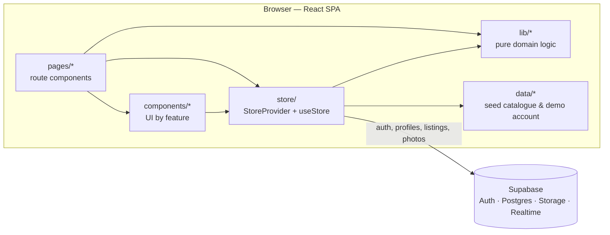

# RE:PLAY

**A circular fashion marketplace prototype: buy pre-owned clothing, see what it could be worth in its next life, then alter, upcycle or resell it.**

Built for SDG Open Hack 2026. Live demo: **[replay-beryl-nu.vercel.app](https://replay-beryl-nu.vercel.app)**


## Overview

Second-hand clothing is usually valued only at its resale price, so most of it is discounted, liquidated or thrown away. RE:PLAY explores a different model: every garment is valued across several possible "next lives" (resale, transformation into a new product, or material recovery), and the user is shown concrete, priced ways to realise that value.

The app is a working front end with real accounts and a shared marketplace backed by Supabase. Valuations, transformation ideas, fit previews, maker matching and all money movements are **deterministic simulations** designed for a repeatable demo (see [Implementation notes](#implementation-notes-and-limitations)).

## Key features

- **Marketplace (Discover).** Browse seeded pre-owned products and items listed by real users, filtered by type and sorted by price, discount or transformation value. Delivery is a flat S$2.99 per order, however many items it holds.
- **Sell an item.** Upload a photo, set a price and condition, preview the listing card, and publish it. Photos go to Supabase Storage. Purchases claim listings atomically, so an item cannot be sold twice.
- **Bag and checkout.** Multi-item orders paid from a simulated RE:PLAY Cash wallet, with an itemised receipt.
- **Valuation.** Each item gets resale, transformation and material-recovery estimates from a deterministic formula (condition, demand, age, category, material, brand).
- **Transform: UPCYCLE.** Exactly three transformation ideas per garment (e.g. jeans → tote, mini skirt, shorts), each with estimated sale price, making cost, delivery and profit. Ideas can be refreshed and filtered by type, style, difficulty, budget and profit, and the closest alternatives are labelled when filters can't be met.
- **Transform: ALTER.** Pick alteration areas (hem, waist, hips, etc.), enter amounts in cm, get a rule-based feasibility check, a price (S$6 per area) and a maker-ready specification.
- **Fit preview.** An SVG model built from the user's height, bust, waist and hips shows where a transformed piece would sit. Measurements are optional and are stored only if the user saves them.
- **RE:PLAY+ (demo tier).** Personalised concepts, a 2D flat sketch and a canvas-rendered 3D preview that update as measurements change, plus saved designs and transformation history. It unlocks instantly; no payment is taken.
- **Life Passport.** A timeline of each item's lives (original purchase → resale → transformation → projected material recovery).
- **Wallet and dashboard.** Portfolio value, next-life potential, earnings by source and a transaction history. Top-ups and withdrawals are simulated.
- **Responsive.** Mobile layout with a bottom tab bar.

## Screenshots

| Discover | Dashboard |
| --- | --- |
|  |  |
| **ALTER studio** | **Life Passport** |
|  |  |

<details>
<summary>More screenshots: landing page, wallet, mobile</summary>

| Landing | Wallet | Mobile |
| --- | --- | --- |
|  |  |  |

</details>

## Technology stack

| Area | Tools |
| --- | --- |
| Front end | React 18, TypeScript (strict), React Router 7 |
| Build | Vite 6 |
| Backend-as-a-service | Supabase: Auth, Postgres with row-level security, Storage, Realtime |
| Graphics | Hand-written SVG (product and fit visuals) and Canvas 2D (low-poly 3D preview); no 3D library |
| Icons | lucide-react |
| Quality | ESLint 9 (typescript-eslint, react-hooks), Vitest 4 |
| Hosting | Vercel (static SPA) |

## System architecture



- **`lib/`** holds the domain logic as pure, deterministic TypeScript functions with no React: valuation, the idea engine, fit model, alteration pricing and feasibility, and order maths. This is the layer the unit tests cover.
- **`store/`** is a single React context. It owns the signed-in session, the per-account state (wallet, owned items, passports, bag, designs), every user action, and synchronisation with Supabase: debounced saves, realtime updates from other devices, and refresh on tab focus.
- **Supabase** stores each account's state as a JSON document in its `profiles` row, plus a shared `listings` table. Row-level security limits writes to the owner, and the `buy_listings()` database function claims listings atomically.

See [docs/ARCHITECTURE.md](docs/ARCHITECTURE.md) for data flow, module responsibilities and the database model.

## Project structure

```text
├── docs/                 Architecture and development guides, screenshots
├── public/               Static assets served as-is (favicon)
├── src/
│   ├── App.tsx           Routes, auth guard, lazy-loaded pages
│   ├── main.tsx          Entry point: router, store provider, global styles
│   ├── pages/            One component per route
│   ├── components/
│   │   ├── common/       Shared primitives (modal, toasts, images, page header)
│   │   ├── layout/       App shell: header, tab bar, profile menu
│   │   ├── product/      Product card and SVG product renderer
│   │   ├── transform/    Upcycle idea cards, filters, cost ledger
│   │   ├── studio/       ALTER / UPCYCLE studios, 2D and 3D previews, saved designs
│   │   ├── fit/          Measurement form, fit model and preview
│   │   └── landing/      Landing-page animation
│   ├── lib/              Domain logic and helpers (with *.test.ts)
│   ├── data/             Seed catalogue and starting demo account
│   ├── store/            App state, Supabase sync and actions
│   ├── services/         Supabase client
│   └── styles/           Global and feature stylesheets
├── supabase/schema.sql   Tables, RLS policies, purchase function, storage bucket
├── vercel.json           SPA rewrite and build settings
└── vite.config.ts
```

## Getting started

**Prerequisites:** Node.js 20 or newer and npm.

```bash
git clone https://github.com/kwek-na-yi/SDG-Open-Hack-2026-REPLAY.git
cd SDG-Open-Hack-2026-REPLAY
npm install
cp .env.example .env.local   # then add your Supabase URL and anon key
npm run dev                  # http://localhost:5180
```

Without Supabase keys the app still starts: the landing page, Discover, product pages and RE:PLAY+ work on seeded data, and the sign-in page explains that accounts aren't connected. Signed-in features need a Supabase project; setup takes about five minutes and is described in [docs/DEVELOPMENT.md](docs/DEVELOPMENT.md#supabase-setup).

## Environment configuration

| Variable | Description |
| --- | --- |
| `VITE_SUPABASE_URL` | Supabase project URL (`https://<project>.supabase.co`) |
| `VITE_SUPABASE_ANON_KEY` | Supabase anon / publishable key |

Both values are bundled into the client, which is how Supabase is designed to work: data access is enforced by the row-level security policies in `supabase/schema.sql`, not by keeping the key secret. Never put a `service_role` key in these variables. `.env.local` is git-ignored.

## Available scripts

| Command | Description |
| --- | --- |
| `npm run dev` | Start the Vite dev server on port 5180 |
| `npm run build` | Type-check and build the production bundle into `dist/` |
| `npm run preview` | Serve the production build locally |
| `npm run typecheck` | Run the TypeScript compiler without emitting |
| `npm run lint` | Lint all TypeScript with ESLint |
| `npm test` | Run the unit tests once (Vitest) |
| `npm run test:watch` | Run the tests in watch mode |

## Implementation notes and limitations

**Real**

- Email/password accounts (Supabase Auth). Each profile, including body measurements and the account's demo state, syncs across devices in real time.
- User listings with photo upload, edit, remove and relist, shared live between all visitors.
- Atomic purchase of user listings via the `buy_listings()` Postgres function.

**Simulated or mocked**

- **All money.** RE:PLAY Cash, top-ups, withdrawals, purchases, maker fees and RE:PLAY+ are demo balances. No payment provider is integrated.
- **"AI" features.** Garment analysis, valuations, transformation ideas, feasibility checks and trend signals are deterministic, rule-based TypeScript functions. There is no machine-learning model or external AI API, and the UI labels these as simulated.
- **Fit and 3D previews** are illustrative drawings derived from a few measurements, not body scans or image generation.
- **Makers, deliveries and transformation progress** are simulated; no real orders are placed.
- **Seeded catalogue.** Products, starting wallet, owned items and passports are static data in `src/data/`. Product photos are hot-linked from Unsplash.
- **Landing-page metrics** (S$1.2M recovered, etc.) are illustrative and labelled as prototype figures.

**Known limitations**

- The per-account demo state is written by the client, so a user could edit their own simulated balance. That is acceptable for a demo but would need server-side validation before any real money were involved.
- Sold listings keep `buyer_id` visible to public reads.
- There are unit tests for the domain logic but no automated end-to-end tests. UI flows were verified manually and with a scripted headless-browser pass.

## Deployment

The app is deployed to Vercel as a static single-page application:

- `vercel.json` sets the framework to Vite, runs `npm run build`, serves `dist/`, and rewrites all paths to `index.html` so client-side routes work on refresh.
- `VITE_SUPABASE_URL` and `VITE_SUPABASE_ANON_KEY` are configured in the Vercel project for Production and Preview.
- The database is provisioned once by running `supabase/schema.sql` in the Supabase SQL editor; the script is idempotent.

Deploy manually with the Vercel CLI (`vercel --prod`), or connect the GitHub repository to the Vercel project for automatic deployments.

## Future improvements

- Move money-affecting actions (purchases, payouts, maker fees) into Postgres functions or edge functions so balances are authoritative on the server.
- Integrate a payment provider in test mode for checkout and RE:PLAY+.
- Add end-to-end tests (e.g. Playwright) for sign-up, selling, checkout and the transform flow, and run lint, tests and build in CI.
- Store transactions and passports in their own tables instead of one JSON document per profile.
- Replace hot-linked product photos with self-hosted, optimised images.
