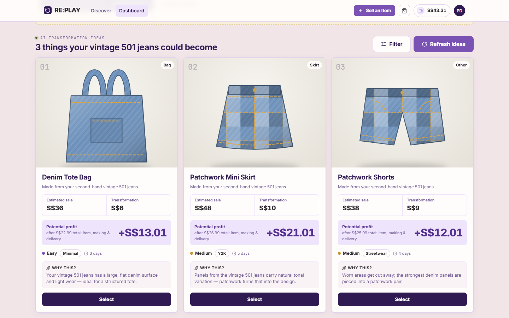
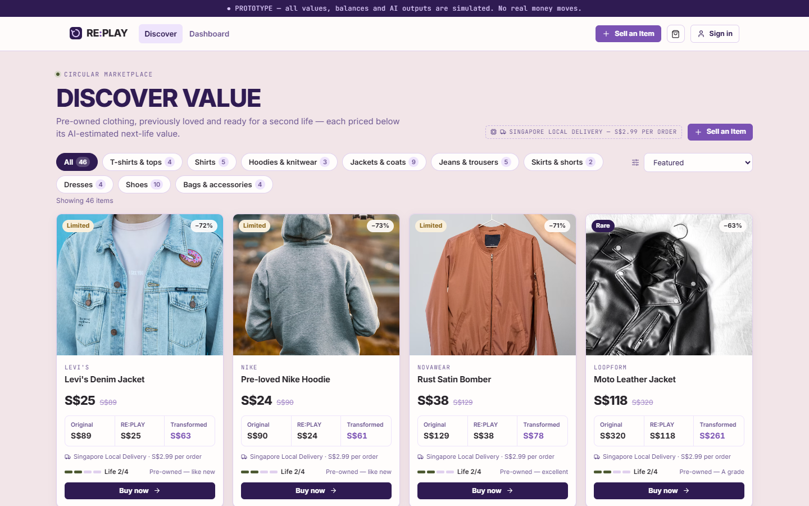
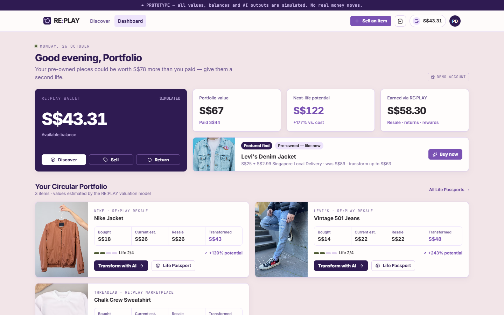
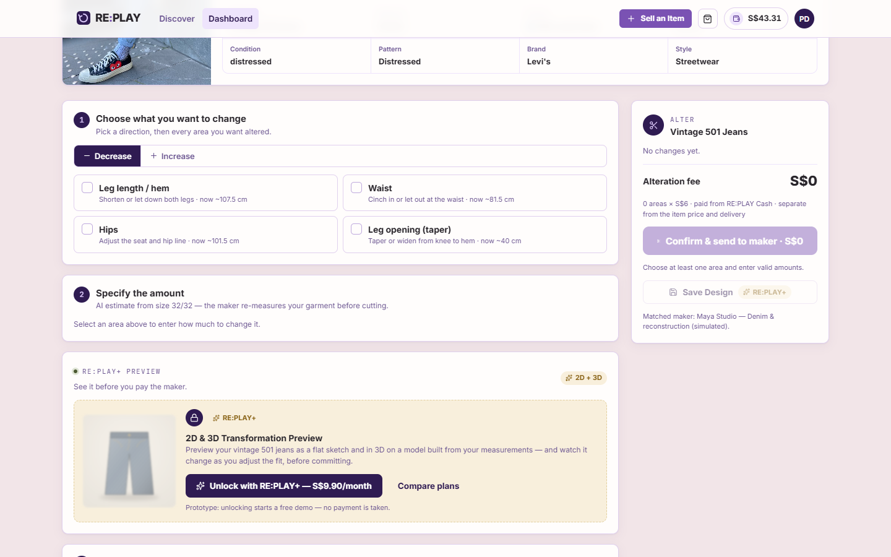
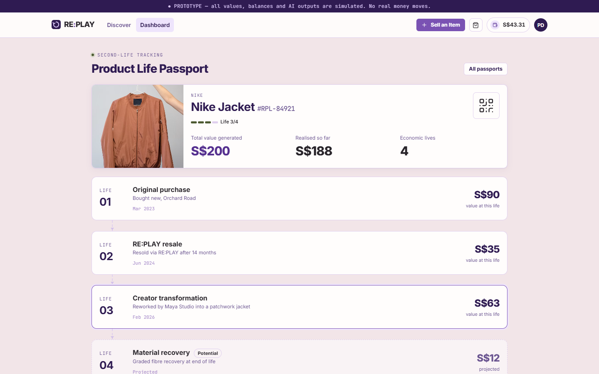
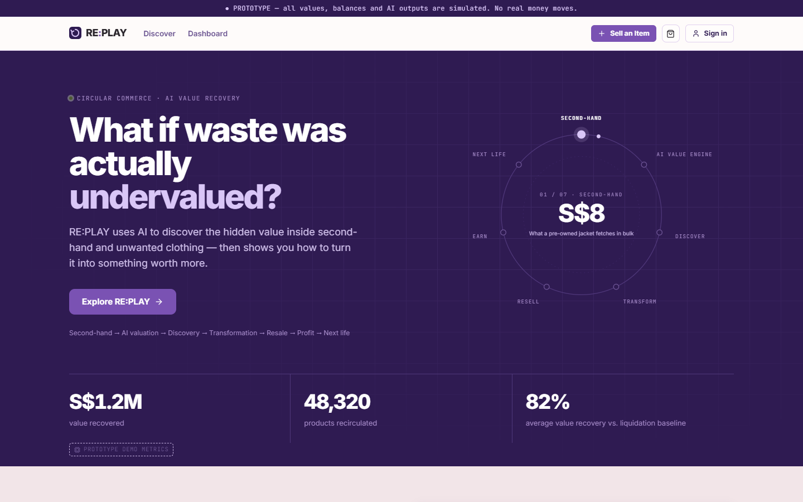
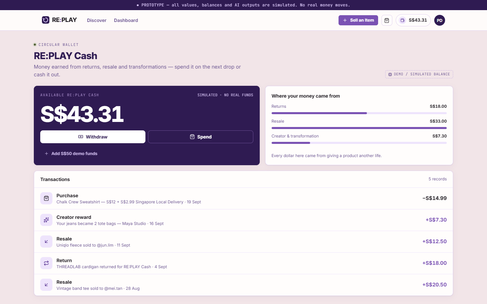
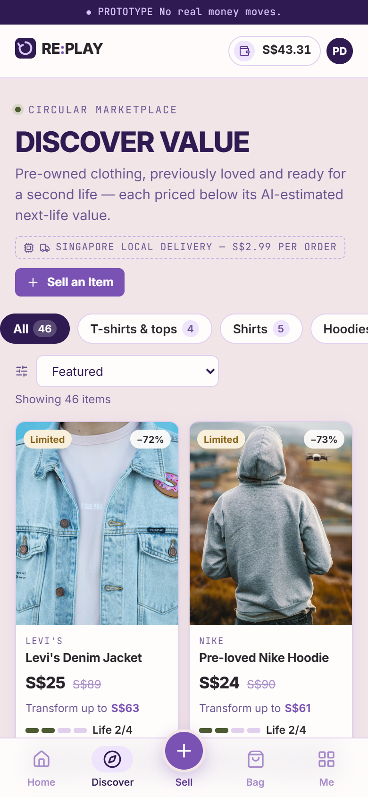
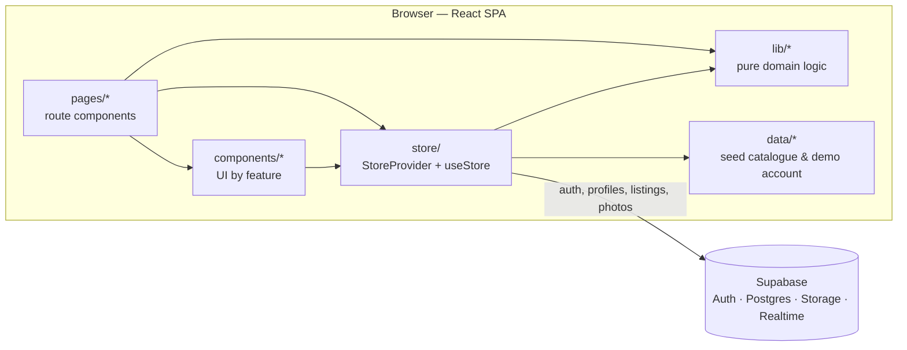

# RE:PLAY

**A circular fashion marketplace prototype: buy pre-owned clothing, see what it could be worth in its next life, then alter, upcycle or resell it.**

Built for **SDG Open Hack 2026**.

**Live demo: [replay-beryl-nu.vercel.app](https://replay-beryl-nu.vercel.app)**. Create an account with any email address to try the signed-in features; no confirmation email is required.



## Problem statement

Clothing that no longer sells or is no longer wanted is treated as having almost no value. Unsold stock typically moves from retail to clearance to liquidation and then to waste, and a second-hand garment is usually judged only by what it would fetch resold as-is. Value that could be recovered through repair, alteration, upcycling or material recovery is rarely considered, so throwing clothing away or letting it sit unused stays the easiest option.

The project's starting point was that this waste is a pricing problem as much as a behavioural one. In the words of the app: *"We don't ask people to consume less. We make it more profitable to circulate what already exists."*

## Proposed solution

RE:PLAY values each garment across several possible next lives and shows the user concrete, priced ways to realise that value:

1. **Value it.** Every item gets resale, transformation and material-recovery estimates, not just a resale price.
2. **Buy it cheaply.** A marketplace of pre-owned items, including items listed by other users, priced below their estimated next-life value.
3. **Give it a next life.** For an owned item, the app proposes three upcycling ideas, each with costs and profit, or prices a fit alteration and produces a maker-ready specification.
4. **Track it.** A Life Passport records each item's lives, from first purchase through resale and transformation to projected material recovery.

The prototype focuses on the consumer journey. The brand and creator sides described on the landing page were explored during the hackathon but are not part of this version.

## Key features

- **Marketplace (Discover).** Browse seeded pre-owned products and items listed by real users, filtered by type and sorted by price, discount or transformation value. Delivery is a flat S$2.99 per order, however many items it holds.
- **Sell an item.** Upload a photo, set a price and condition, preview the listing card, and publish it. Photos go to Supabase Storage. Purchases claim listings atomically, so an item cannot be sold twice.
- **Bag and checkout.** Multi-item orders paid from a simulated RE:PLAY Cash wallet.
- **Valuation.** A deterministic formula estimates each item's value from its condition, demand, age, category, material and brand.
- **Transform: UPCYCLE.** Exactly three ideas per garment (e.g. jeans → tote, mini skirt, shorts), each with estimated sale price, making cost, delivery and profit. Ideas can be refreshed and filtered by type, style, difficulty, budget and profit, and the closest alternatives are labelled when filters can't be met.
- **Transform: ALTER.** Choose alteration areas (hem, waist, hips, etc.) and amounts in cm, and get a rule-based feasibility check, a price (S$6 per area) and a maker-ready specification.
- **Fit preview.** An SVG model built from height, bust, waist and hips shows where a transformed piece would sit. Measurements are optional and saved only if the user chooses.
- **RE:PLAY+ (demo tier).** Personalised concepts, a 2D flat sketch and a canvas-rendered 3D preview that update as measurements change, plus saved designs and transformation history. It unlocks instantly; no payment is taken.
- **Life Passport, wallet and dashboard.** Item timelines, portfolio value, next-life potential, earnings by source and transaction history.
- **Responsive.** Mobile layout with a bottom tab bar.

## Screenshots

| Discover | Dashboard |
| --- | --- |
|  |  |
| **ALTER studio** | **Life Passport** |
|  |  |

<details>
<summary>More screenshots: landing page, wallet, mobile</summary>

| Landing | Wallet | Mobile |
| --- | --- | --- |
|  |  |  |

</details>

## Technology stack

| Area | Tools |
| --- | --- |
| Front end | React 18, TypeScript (strict), React Router 7 |
| Build | Vite 6 |
| Backend-as-a-service | Supabase: Auth, Postgres with row-level security, Storage, Realtime |
| Graphics | Hand-written SVG (product and fit visuals) and Canvas 2D (low-poly 3D preview); no 3D library |
| Icons | lucide-react |
| Quality | ESLint 9 (typescript-eslint, react-hooks), Vitest 4 |
| Hosting | Vercel (static SPA) |

Supabase was chosen so the app could have real accounts, a shared marketplace and cross-device sync without writing or hosting a custom server. Security is enforced in the database through row-level security policies rather than in a backend.

## Architecture



- **`lib/`** holds the domain logic as pure, deterministic TypeScript functions with no React: valuation, the idea engine, fit model, alteration pricing and feasibility, and order maths. This is the layer the unit tests cover.
- **`store/`** is a single React context. It owns the session, the per-account state (wallet, owned items, passports, bag, designs), every user action, and synchronisation with Supabase: debounced saves, realtime updates from other devices, and refresh on tab focus.
- **Supabase** stores each account's state as a JSON document in its `profiles` row, plus a shared `listings` table. Row-level security limits writes to the owner, and the `buy_listings()` database function claims listings atomically.

See [docs/ARCHITECTURE.md](docs/ARCHITECTURE.md) for routes, data flow and the database model.

## Project structure

```text
├── docs/                 Architecture and development guides, screenshots
├── public/               Static assets served as-is (favicon)
├── src/
│   ├── App.tsx           Routes, auth guard, lazy-loaded pages
│   ├── main.tsx          Entry point: router, store provider, global styles
│   ├── pages/            One component per route
│   ├── components/       UI grouped by feature: common, layout, product,
│   │                     transform, studio, fit, landing
│   ├── lib/              Domain logic and helpers (with *.test.ts)
│   ├── data/             Seed catalogue and starting demo account
│   ├── store/            App state, Supabase sync and actions
│   ├── services/         Supabase client
│   └── styles/           Global and feature stylesheets
├── supabase/schema.sql   Tables, RLS policies, purchase function, storage bucket
├── vercel.json           SPA rewrite and build settings
└── vite.config.ts
```

## Local setup

**Prerequisites:** Node.js 20 or newer and npm.

```bash
git clone https://github.com/kwek-na-yi/SDG-Open-Hack-2026-REPLAY.git
cd SDG-Open-Hack-2026-REPLAY
npm install
npm run dev        # http://localhost:5180
```

### Configuration

Signed-in features need a Supabase project. Create a file named `.env.local` in the project root (it is git-ignored) containing:

| Variable | Required | Description |
| --- | --- | --- |
| `VITE_SUPABASE_URL` | For accounts, selling and sync | Project URL, `https://<project>.supabase.co` |
| `VITE_SUPABASE_ANON_KEY` | For accounts, selling and sync | The project's anon (publishable) key |

Without these variables the app still starts: the landing page, Discover, product pages and RE:PLAY+ work on seeded data, and the sign-in page explains that accounts aren't connected.

Both values are bundled into the browser by design. Data access is protected by the row-level security policies in `supabase/schema.sql`, not by keeping the key secret, so never use a `service_role` key here. Provisioning the database takes about five minutes; see [docs/DEVELOPMENT.md](docs/DEVELOPMENT.md#supabase-setup).

## Testing

| Command | What it runs |
| --- | --- |
| `npm test` | Vitest unit tests for the domain logic: valuation, idea engine, fit validation, order maths, listing mapping, redirect safety and saved-profile loading |
| `npm run lint` | ESLint, including React Hooks rules |
| `npm run typecheck` | Strict TypeScript compilation |
| `npm run build` | Type-check and production build |

The user journeys (sign-up, buying, selling, both Transform modes, Passport, Wallet and the mobile layout) were checked with a scripted headless-browser run against the production build and the live site. That script isn't part of the repository; adding committed end-to-end tests is listed under future work. More detail is in [docs/DEVELOPMENT.md](docs/DEVELOPMENT.md#tests).

## Limitations

**Real:** email/password accounts, profiles synced across devices in real time, user listings with photo upload, and atomic purchase of listings.

**Simulated:**

- **All money.** RE:PLAY Cash, top-ups, withdrawals, purchases, maker fees and RE:PLAY+ are demo balances. No payment provider is integrated.
- **"AI" features.** Garment analysis, valuations, transformation ideas, feasibility checks and trend signals are deterministic, rule-based functions. There is no machine-learning model or external AI API, and the UI labels these as simulated.
- **Fit and 3D previews** are illustrative drawings derived from a few measurements.
- **Makers, deliveries and transformation progress** are simulated; no real orders are placed.
- **Seeded catalogue.** Products, the starting wallet, owned items and passports are static data. Product photos are hot-linked from Unsplash.
- **Landing page.** Its headline metrics are illustrative and labelled as prototype figures, and its brand and creator cards describe parts of the concept that are not implemented in this version.

**Known constraints:**

- The per-account demo state is written by the client, so a user could edit their own simulated balance. That is acceptable for a demo, but money would need server-side validation.
- Sold listings keep `buyer_id` visible to public reads.
- There are no committed end-to-end tests or CI pipeline yet.

## Deployment

The app is deployed to **Vercel** as a static single-page application at **https://replay-beryl-nu.vercel.app** (production).

- `vercel.json` builds with `npm run build`, serves `dist/`, and rewrites all paths to `index.html` so client-side routes survive a refresh.
- `VITE_SUPABASE_URL` and `VITE_SUPABASE_ANON_KEY` are set in the Vercel project for Production and Preview.
- The database is provisioned once by running `supabase/schema.sql` in the Supabase SQL editor; the script is idempotent.
- To deploy changes, run `vercel` for a preview deployment, verify it, then run `vercel --prod`.

## Future work

- Move money-affecting actions into Postgres functions or edge functions so balances are authoritative on the server.
- Integrate a payment provider in test mode for checkout and RE:PLAY+.
- Commit end-to-end tests (e.g. Playwright) for the main journeys, and run lint, tests and build in CI.
- Store transactions and passports in their own tables instead of one JSON document per profile.
- Self-host and optimise product images.

## Competition

RE:PLAY was created for SDG Open Hack 2026. After the event, the code was reorganised, tested and documented for this portfolio. The design is unchanged; changes to the app were limited to bug, security, accessibility and performance fixes.

## Licence

No licence has been chosen yet, so all rights are reserved by the authors. Product photos are from [Unsplash](https://unsplash.com) and are subject to the Unsplash License.
