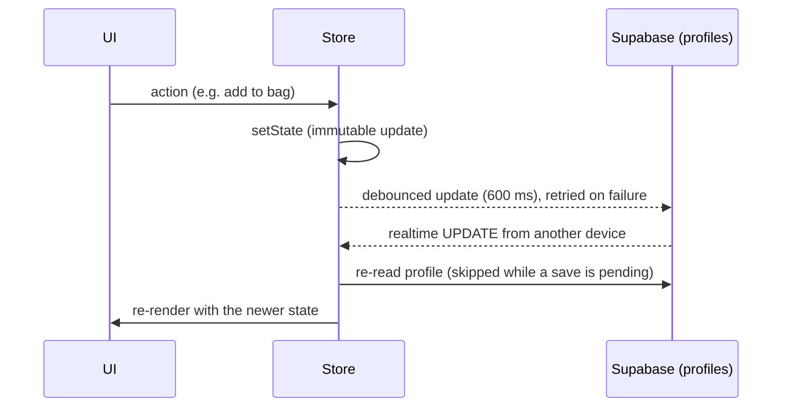

# Architecture

RE:PLAY is a client-rendered React single-page app. Supabase provides authentication, a Postgres database, file storage and realtime change feeds; there is no custom server. This document describes how the code is layered, how data moves, and what the database holds.

## Layers

| Layer | Folder | Responsibility | Depends on |
| --- | --- | --- | --- |
| Routing | `src/App.tsx` | Route table, `RequireAuth` guard, lazy-loaded pages | pages, store |
| Pages | `src/pages/` | One component per route; composes feature components and calls store actions | components, store, lib |
| Components | `src/components/<feature>/` | Presentational and feature UI, grouped by feature | lib, store (a few connected components) |
| State | `src/store/` | Session, per-account state, user actions, Supabase sync | lib, data, services |
| Domain logic | `src/lib/` | Pure, deterministic functions and types. No React, no network | lib only |
| Data | `src/data/` | Seed catalogue and the starting demo account | lib (types) |
| Services | `src/services/` | Configured Supabase client | — |

Domain logic never imports from components or the store, which keeps it unit-testable. Shared drawable-shape types live in `lib/mock.ts` for the same reason.

## Routes

| Path | Page | Access |
| --- | --- | --- |
| `/` | Landing | Public |
| `/discover` | Marketplace | Public |
| `/buy/:id` | Product detail, checkout and "next life" reveal | Public; paying requires sign-in |
| `/plus` | RE:PLAY+ plans and demo activation | Public |
| `/account` | Sign in / sign up, then profile, measurements, listings, designs | Public |
| `/dashboard` (alias `/me`) | Portfolio, wallet summary, resale and return actions | Signed in |
| `/bag` | Multi-item checkout | Signed in |
| `/sell` | Create or edit a listing (`?edit=<id>`) | Signed in |
| `/transform/:itemId` | ALTER / UPCYCLE studio for an owned item | Signed in |
| `/passport`, `/passport/:id` | Life Passports | Signed in |
| `/wallet` | RE:PLAY Cash balance and transactions | Signed in |

Signed-out visitors who open a protected route are sent to `/account?next=<path>` and returned there after signing in. `safeRedirect()` in `lib/account.ts` only accepts same-site paths. Routes from features removed after the hackathon (`/brand`, `/business`, `/marketplace`, `/challenges`, `/drops/*`) redirect so that old links still work.

Landing, Discover and the product page ship in the main bundle; every other page is a separate chunk. React/React Router and Supabase are split into their own vendor chunks (`vite.config.ts`).

## Domain modules (`src/lib`)

| Module | What it does |
| --- | --- |
| `engine.ts` | `calculateCircularValue()`: resale, transformation, material-recovery and liquidation values from hand-tuned coefficients. `allocateInventory()` splits a bulk lot across four channels (used for the landing-page example). |
| `ideas.ts` | The UPCYCLE idea engine. `profileOf()` turns an owned item into a garment profile; `recommend()` returns exactly three ideas for a profile, filter set and refresh round, putting exact matches first and labelling the closest alternatives with `misses`. |
| `studio.ts` | ALTER and RE:PLAY+ logic: per-area pricing (S$6), estimated garment measurements by category and size, rule-based feasibility, personalised concepts, simulated trend signals, maker matching and maker-ready specs. |
| `fit.ts` | Measurement validation, size estimation, and body landmarks for the SVG fit model. |
| `orders.ts` | Order totals with one flat delivery fee per order, and an exact per-item split of that fee. |
| `account.ts` | User type, name and handle helpers, sign-in validation, friendly auth errors, `safeRedirect()`. |
| `listings.ts` | Listing types, sell-form options, and mapping between `listings` rows and the `Product` shape. |
| `format.ts`, `colour.ts`, `mock.ts` | Currency formatting, colour maths for garment drawings, drawable-shape types. |

Every function here is deterministic: the same inputs always give the same output, which keeps the demo repeatable and the tests simple.

## State and data flow

`StoreProvider` (`src/store/store.tsx`) exposes one context value through `useStore()`. It contains:

- `user`, `ready`: the Supabase session, restored on load.
- `state`: the account's `State` (`src/store/state.ts`), made up of wallet transactions, owned items (`portfolio`), Life Passports, bag, active transformations, saved designs, measurements, RE:PLAY+ status and style profile.
- `products`, `listings`: the seeded catalogue merged with users' active listings.
- Actions such as `buyOrder`, `createListing`, `startTransformation`, `startAlteration`, `saveDesign`, `withdraw` and `resetDemo`. Each action is an immutable state update, and many also call Supabase.

### Account sync

- On sign-in the store reads the `profiles` row, or creates it if the sign-up trigger hasn't, and maps it to `State` with `stateFromProfile()`. That function keeps only keys the current version knows, so older saves carrying data from removed features are cleaned up, and it discards malformed saved designs.
- Each state change is serialised and compared with the last synced copy. Unchanged state is never written, and the store's own writes echoing back over realtime are ignored.
- Pending saves are flushed when the tab is hidden or closed. When the tab regains focus, listings and the profile are refreshed.
- Signed-out visitors browse on an unsaved copy of the seed data.

### Buying

1. `orderTotals()` prices the order: item prices plus one S$2.99 delivery fee.
2. For user listings, `buy_listings(ids)` runs in Postgres and marks only still-active listings as sold to the caller, returning the ids it claimed. Items someone else bought first are dropped from the order before anything is charged.
3. The store debits RE:PLAY Cash, adds each item to the portfolio with its share of the delivery fee (`splitDelivery()`), and creates a Life Passport.

### Transforming

UPCYCLE: `profileOf(item)` → `recommend()` → the user selects an idea → optional fit preview → `startTransformation()` debits the making cost and records a design → `completeTransformation()` turns the item into the new product and adds a passport life → `sellTransformed()` credits the sale.

ALTER: the user chooses areas and amounts → feasibility and price from `studio.ts` → `startAlteration()` → `completeAlteration()` returns the same item with an "Alteration" life.

## Database (`supabase/schema.sql`)

| Object | Purpose | Access |
| --- | --- | --- |
| `profiles` | One row per user: name, handle, `fit_profile`, `fit_reminder_off`, and `state` (JSON demo state) | Owner only (select, insert, update) |
| `handle_new_user()` trigger | Creates the profile row on sign-up | Runs as definer |
| `listings` | User listings: price, category, condition, status (`active`/`sold`/`removed`), photo URL | Anyone can read non-removed listings; sellers create and edit their own unsold listings and can never mark them sold |
| `buy_listings(uuid[])` | Atomic purchase; refuses the buyer's own listings | Authenticated users only |
| `listing-images` bucket | Public listing photos (JPEG/PNG/WebP, ≤ 3 MB) | Users write only inside their own `<user id>/` folder |
| Realtime publication | Broadcasts changes to `listings` and `profiles` | Subject to the table policies above |

## Rendering without image services

Product ideas, transformed items and the fit model are drawn locally rather than loaded from an image API:

- `components/product/ProductMock.tsx` draws 33 garment and product shapes as SVG in the source garment's colour and fabric.
- `components/fit/FitModel.tsx` draws a body from measurement-derived landmarks and places the item on it.
- `components/studio/GarmentFlat.tsx` (SVG) and `Garment3D.tsx` (Canvas 2D, a hand-built low-poly mesh) render the RE:PLAY+ previews, which update as measurements change.

Only the seeded catalogue photos are external (Unsplash). If a photo fails to load, `ProductImage` shows the item name instead, and owned items fall back to their drawn mock.
